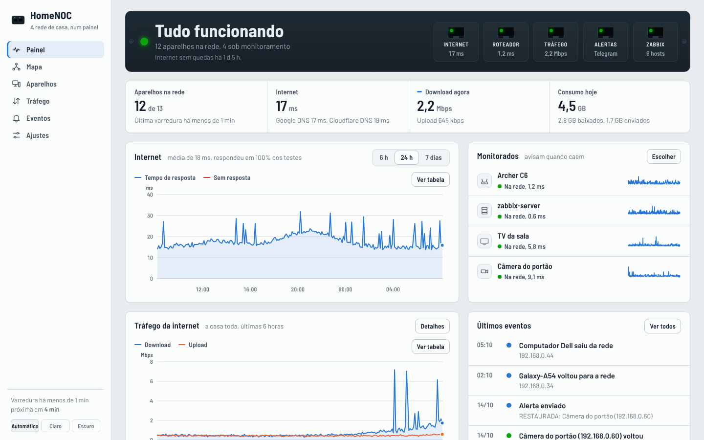
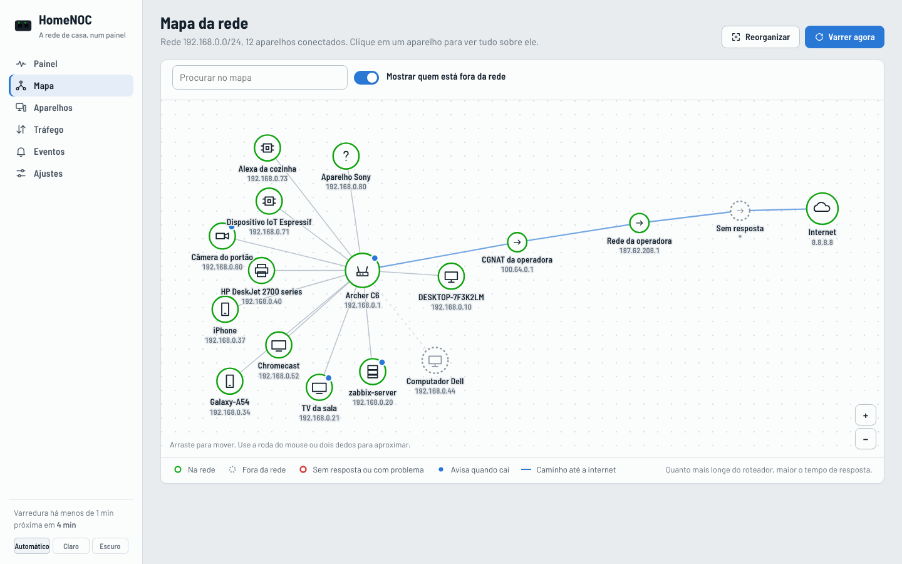
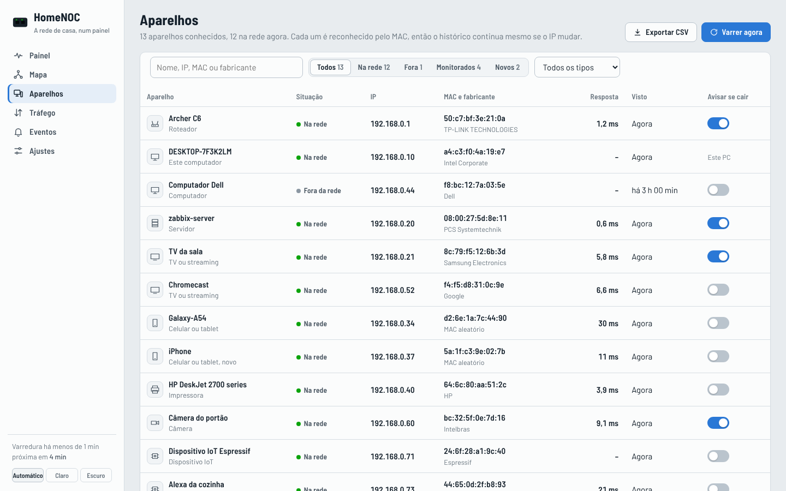
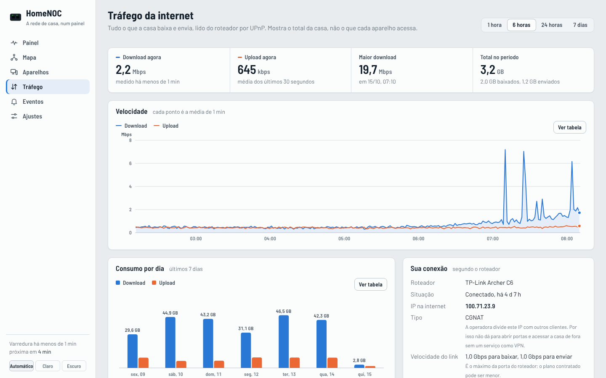
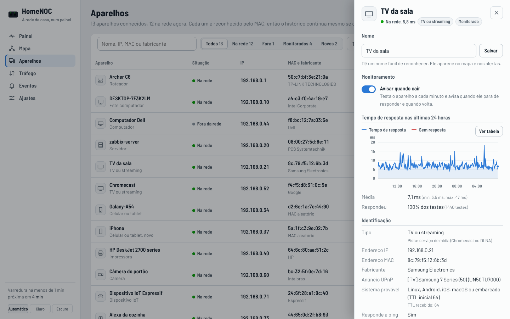
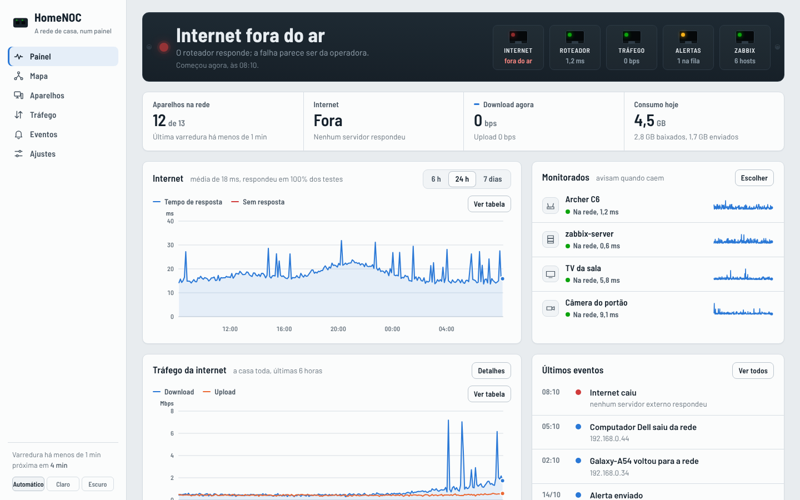
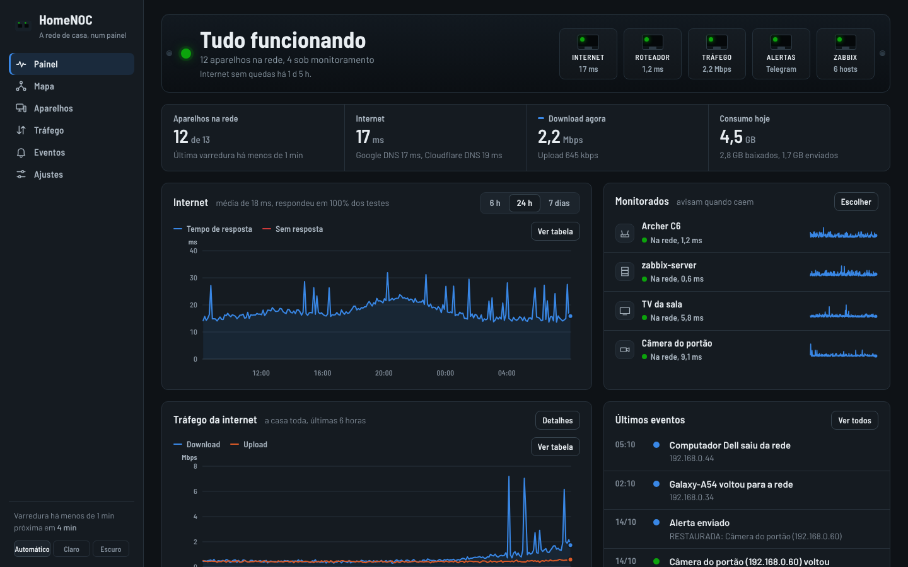
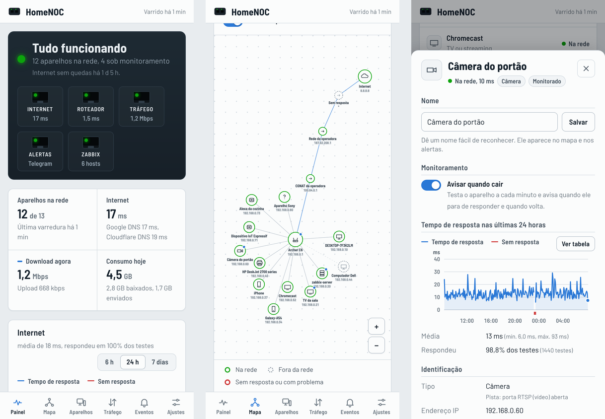
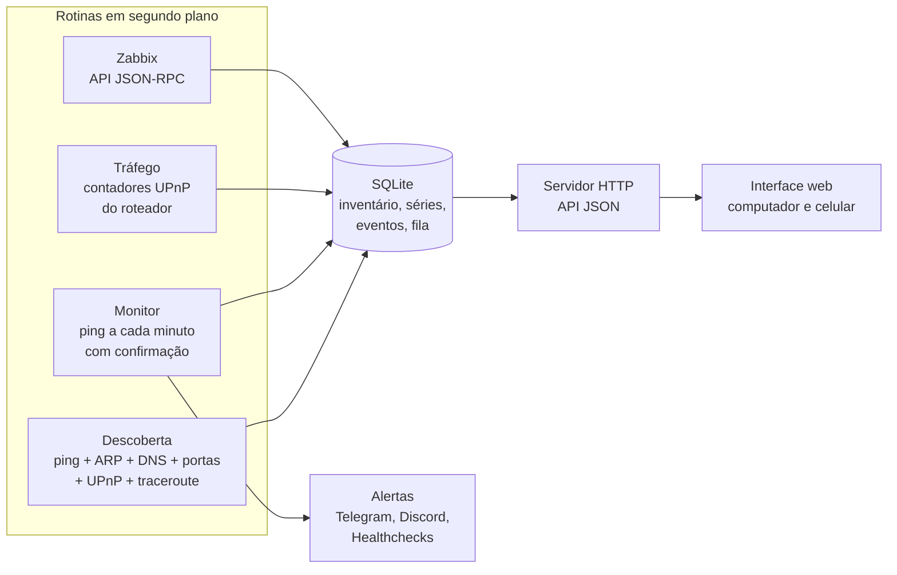

# HomeNOC

**Um mini-NOC para a rede de casa.** Ele encontra os aparelhos da rede, desenha a topologia, acompanha a internet e o tráfego, e avisa no celular quando algo cai e quando volta. Feito em Python, sem dependências externas, para rodar num notebook com Windows (ou num Linux / Raspberry Pi).

[](https://github.com/isaacrpg231-sys/homenoc/actions/workflows/testes.yml)


**[Abrir a demonstração online](https://isaacrpg231-sys.github.io/homenoc/)**: uma rede simulada no navegador, sem instalar nada. Clique em "Simular queda da internet" e veja o painel reagir.



## O que ele faz

| | |
|---|---|
| **Descoberta e inventário** | Varre a sub-rede a cada 5 minutos (ping + tabela ARP) e identifica cada aparelho pelo MAC: fabricante (base oficial do IEEE), nome na rede, anúncio UPnP, portas abertas e um palpite do tipo (TV, celular, impressora...) com o motivo do palpite. Se o roteador trocar o IP de um aparelho, o histórico continua. |
| **Mapa da rede** | Topologia interativa no estilo do Zenmap: o roteador no centro, cada aparelho a uma distância proporcional à latência e o caminho até a internet salto a salto, com detecção de **CGNAT** e **NAT duplo**. Clique em qualquer ponto para ver tudo sobre ele. |
| **Monitoramento** | Ping na internet (dois servidores) e nos aparelhos escolhidos a cada minuto. Antes de alertar, testa de novo para evitar alarme falso, e explica a causa provável ("o roteador responde; a falha parece ser da operadora"). |
| **Alertas no celular** | Telegram e Discord, com a mensagem de queda e a de **rede restaurada** (com o tempo fora). Sem internet, os alertas esperam numa fila e saem quando ela volta. O Healthchecks.io avisa se o próprio computador desligar. |
| **Tráfego da internet** | Download e upload da casa toda, lidos do roteador por **UPnP** (sem instalar nada nele), consumo por dia, IP público e velocidade do link. |
| **Acesso pelo celular** | O mesmo painel no celular, pelo Wi-Fi de casa, com senha e QR code para abrir. |
| **Zabbix (opcional)** | Mostra os hosts, o ping e os problemas do Zabbix dentro do painel. Inclui um [guia completo](integracoes/zabbix/README.md) para montar o Zabbix 7.0 LTS numa VM. |
| **Histórico** | Eventos (quedas, retornos, aparelhos novos e alertas enviados), gráficos de 1 hora a 7 dias e o inventário em CSV. |

## Telas

| Mapa da rede | Aparelhos |
|---|---|
|  |  |
| **Tráfego da internet** | **Detalhes de um aparelho** |
|  |  |
| **Queda da internet** | **Tema escuro** |
|  |  |



## Como usar

### No Windows

1. Instale o **Python 3.10 ou mais novo** em [python.org](https://www.python.org/downloads/). Na instalação, marque **"Add python.exe to PATH"**.
2. Baixe este projeto (**Code → Download ZIP**) e extraia numa pasta.
3. Dê dois cliques em **`iniciar.bat`**. O painel abre no navegador em `http://127.0.0.1:8765`.

Na primeira vez, o Windows pode perguntar se o Python pode usar a rede: permita em **redes privadas**. A primeira varredura leva cerca de um minuto. Depois:

- em **Aparelhos**, ligue **"Avisar quando cair"** nos aparelhos importantes (o roteador já vem ligado);
- em **Ajustes → Alertas**, configure o Telegram (o passo a passo está na própria tela) e clique em **Enviar mensagem de teste**;
- em **Ajustes → Este computador**, ligue **"Abrir o HomeNOC quando o Windows iniciar"** para ele rodar em segundo plano, sem janela.

Quer só ver como é, sem tocar na sua rede? Dê dois cliques em **`demonstracao.bat`**.

### No Linux ou no Raspberry Pi

```bash
git clone https://github.com/isaacrpg231-sys/homenoc.git
cd homenoc
python3 -m homenoc              # abre em http://127.0.0.1:8765
python3 -m homenoc --demo       # demonstração com uma rede simulada
```

Opções: `--porta 8766`, `--dados /outra/pasta`, `--sem-navegador`, `--demo`.

Para iniciar junto com o sistema, um serviço do systemd (troque o usuário e a pasta):

```ini
# /etc/systemd/system/homenoc.service
[Unit]
Description=HomeNOC
After=network-online.target

[Service]
User=pi
WorkingDirectory=/home/pi/homenoc
ExecStart=/usr/bin/python3 -m homenoc --sem-navegador
Restart=on-failure

[Install]
WantedBy=multi-user.target
```

```bash
sudo systemctl enable --now homenoc
```

## Como funciona



Cada rotina roda na sua própria thread e grava num banco SQLite. A interface é uma página só (HTML, CSS e JavaScript puros), que lê a API a cada poucos segundos. Os gráficos e o mapa são desenhados em SVG, sem bibliotecas.

| Módulo | O que faz |
|---|---|
| `homenoc/rede.py` | ping, tabela ARP, rota padrão, traceroute, portas e a leitura das saídas do Windows e do Linux |
| `homenoc/descoberta.py` | varredura da sub-rede e inventário (aparelho novo, que saiu, que voltou) |
| `homenoc/upnp.py` | SSDP, descrição dos aparelhos UPnP e contadores do roteador (também roda sozinho para o Zabbix) |
| `homenoc/monitor.py` | ciclo de monitoramento, confirmação de queda, diagnóstico e texto dos alertas |
| `homenoc/alertas.py` | Telegram, Discord, Healthchecks e a fila para quando a internet cai |
| `homenoc/trafego.py` | velocidade a partir dos contadores, tratando a volta do contador de 32 bits |
| `homenoc/zabbix.py` | leitura do Zabbix pela API com token somente leitura |
| `homenoc/banco.py` | SQLite: inventário, séries de latência e tráfego, eventos e fila |
| `homenoc/servidor.py` | servidor HTTP, API JSON e proteções de acesso |
| `homenoc/web/` | a interface: painel, mapa, aparelhos, tráfego, eventos e ajustes |

### Técnicas de rede usadas

- **Varredura ICMP** da sub-rede em paralelo (64 threads) e leitura da **tabela ARP**, que encontra até quem bloqueia ping.
- **Fabricante pelo OUI** (primeira metade do MAC) com a lista oficial do IEEE, e detecção de **MAC aleatório** (bit "localmente administrado"), comum em celulares.
- **DNS reverso (PTR)** para o nome do aparelho e **TTL** do ping para o palpite do sistema operacional (64, 128 ou 255).
- **Teste de 20 portas TCP comuns** (só na própria rede, a cada 6 horas por aparelho) para reconhecer impressoras (9100, 631), câmeras (554), Chromecast (8008/8009) e outros.
- **SSDP/UPnP**: busca M-SEARCH por multicast, leitura do XML de descrição e chamadas **SOAP** ao serviço `WANCommonInterfaceConfig` do roteador (bytes enviados e recebidos, velocidade do link) e ao `WANIPConnection` (IP público, tempo conectado).
- **Traceroute** até a internet, identificando a faixa **100.64.0.0/10 (CGNAT)** e endereços privados depois do roteador (**NAT duplo**).
- **Séries temporais** agregadas em baldes no SQLite (média, perda de pacotes e disponibilidade) e retenção configurável.
- **API JSON-RPC do Zabbix** com token Bearer e papel de usuário com lista de métodos permitidos.

## Segurança

- Por padrão o HomeNOC **só escuta no próprio computador** (`127.0.0.1`). Nada fica exposto na internet.
- O acesso pelo celular é opcional, só pela rede local e **exige senha**, guardada como hash **PBKDF2** (200 mil iterações). A sessão usa cookie `HttpOnly` e `SameSite=Strict`, e muitas senhas erradas bloqueiam novas tentativas por 5 minutos.
- Pedidos que mudam algo exigem um cabeçalho próprio (proteção contra **CSRF**) e o cabeçalho `Host` é conferido (proteção contra **DNS rebinding**).
- Tokens e webhooks **nunca voltam inteiros** para o navegador (aparecem como `••••1234`). Alguns ajustes, como a senha e o encerramento, só podem ser mudados no próprio computador.
- No Zabbix, o HomeNOC usa um usuário **somente leitura**.
- A varredura e o teste de portas ficam **restritos à sub-rede local**. Use o HomeNOC apenas em redes que são suas ou que você tem autorização para monitorar.

## Testes

```bash
python -m unittest discover -s tests -v
```

São mais de 100 testes automatizados que **não tocam na sua rede**: o ping, o roteador UPnP, o Telegram, o Discord e o Zabbix são simulados. Eles cobrem a leitura das saídas do Windows e do Linux (em português e em inglês), a confirmação de quedas, a fila de alertas, a volta do contador de 32 bits, a validação dos ajustes e as proteções da API. O GitHub Actions roda tudo no Linux e no Windows a cada envio.

## Estrutura

```
homenoc/
├── homenoc/            o programa (Python, só a biblioteca padrão)
│   └── web/            a interface (HTML, CSS e JavaScript, sem build)
├── tests/              testes automatizados
├── integracoes/zabbix/ guia e templates para o Zabbix 7.0 LTS
├── docs/img/           capturas de tela
├── iniciar.bat         abre o HomeNOC no Windows
├── demonstracao.bat    abre a demonstração
└── HomeNOC.pyw         abre sem janela (usado no início automático)
```

## Limitações conhecidas

- O tráfego é o **total da casa**: o UPnP do roteador não informa quanto cada aparelho usou.
- Alguns roteadores de operadora vêm com o UPnP desligado ou bloqueado; aí a parte de tráfego fica indisponível e o resto funciona normalmente.
- Celulares em economia de energia às vezes não respondem ao ping. Por isso o aviso de queda só vem ligado no roteador: ligue nos aparelhos que ficam sempre conectados.
- A descoberta é só IPv4.
- O monitoramento roda enquanto o computador estiver ligado (o Healthchecks.io avisa quando ele para).

## Autor e como o projeto foi feito

**Isaac Ramos Pereira**, estudante de Técnico em Redes (cursos Cisco: IT Essentials, CCNA ITN e CCNA SRWE).

O HomeNOC é um projeto meu: a ideia, o que ele deveria fazer e as decisões de como ele funciona vieram de mim, a partir de três versões anteriores (um monitor com alertas no Telegram, a integração com o Zabbix e um mapa de topologia). Eu coloquei o HomeNOC para rodar e testei na minha própria rede.

O código foi escrito pelo Claude, a IA da Anthropic, a partir das minhas especificações e correções.

- LinkedIn: [isaac-ramos-pereira](https://www.linkedin.com/in/isaac-ramos-pereira-526273328)
- GitHub: [isaacrpg231-sys](https://github.com/isaacrpg231-sys)

## Licença

[MIT](LICENSE). As fontes Barlow seguem a SIL Open Font License e o gerador de QR code (qrcode-generator) a licença MIT.
